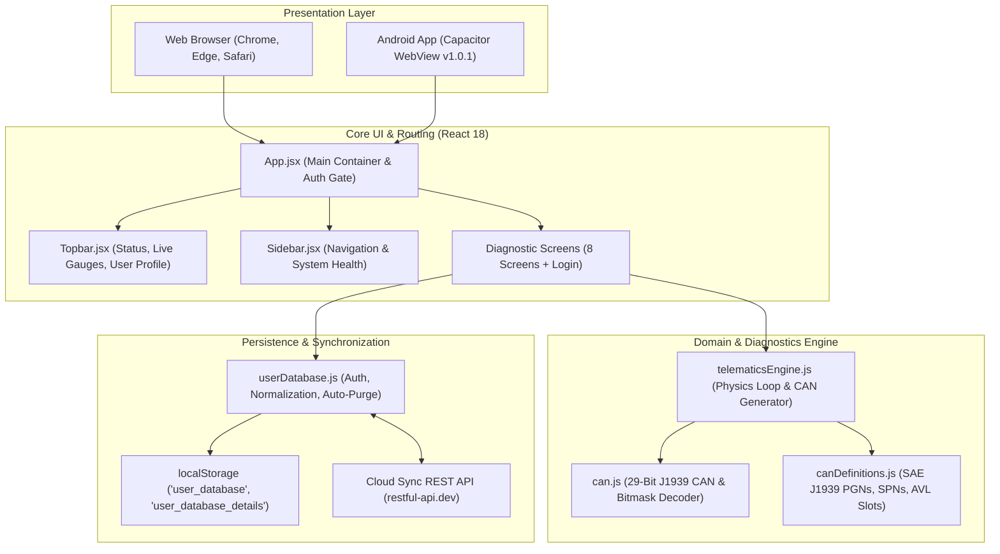

# HAULOOP FMC650 CAN DIAGNOSTICS & TELEMATICS CONSOLE
## Comprehensive Knowledge Transfer (KT) Document

---

## 1. Document Overview & Metadata

| Metadata Field | Details |
| :--- | :--- |
| **Project Name** | Hauloop FMC650 CAN Diagnostics & Telematics Console |
| **Current Version** | `1.0.1` (Android `versionCode 2`) |
| **Primary Platforms** | Responsive Web App (Desktop / Tablet / Mobile) & Native Android APK |
| **GitHub Repository** | [`https://github.com/Yuvaraj-3604/Hauloop_Diagnostics.git`](https://github.com/Yuvaraj-3604/Hauloop_Diagnostics.git) |
| **Target Audience** | Frontend Developers, Embedded Telematics Engineers, Fleet System Integrators, QA, and DevOps |
| **Hardware Target** | Teltonika Telematics FMC650 (Advanced 4G LTE Cat 1/GNSS Tracker with Dual CAN J1939) |
| **Standard Protocols** | SAE J1939, ISO 11898 (CAN 2.0B 29-bit Extended), Teltonika Codec 8 / 8 Extended |

---

## 2. System Purpose & Business Context

### 2.1 The Problem
In heavy-duty commercial transport, mining haulers, and construction dump trucks (e.g., Tata Signa 4825.TK, BharatBenz 3528C, Ashok Leyland Captain), vehicles broadcast hundreds of diagnostic and operational parameters across internal High-Speed CAN buses at 250 kbps or 500 kbps using the **SAE J1939 standard**.

Field diagnostics often suffer from:
1. **Proprietary Hardware Lock-In**: Specialized diagnostic tools are expensive, bulky, and restricted to service bays.
2. **Raw Hex Data Obfuscation**: Raw CAN messages (e.g. `0x18FEEE00 [8] 60 7D 7D 24 00 00 FF FF`) cannot be readily interpreted by fleet operators without bit-mask unpacking and scaling conversion.
3. **Teltonika FMC650 Mapping Gaps**: Fleet managers using Teltonika FMC650 GPS trackers need to configure 15 Manual CAN filter slots and map them to AVL Element IDs for cloud telematics. Testing these configurations historically required physically connecting to a running truck.

### 2.2 The Solution
**Hauloop FMC650 CAN Diagnostics** provides a complete diagnostic workstation directly inside modern web browsers and an Android APK. It combines:
- A high-fidelity, real-time **in-browser Telematics Physics Engine** simulating live vehicle dynamics across 6 operational profiles (Highway, Uphill Haul, Overheating, Low Oil Pressure, Harsh Braking, Idle).
- An authentic **29-bit J1939 Protocol Parser** that unpacks Parameter Group Numbers (PGNs) and Suspect Parameter Numbers (SPNs) with exact bit offsets, endianness (Intel/Motorola), and mathematical scaling formulas.
- A **Teltonika FMC650 Configuration & AVL Mapping Lab** illustrating how raw CAN slots (00 to 14) translate into Teltonika AVL Element IDs.
- **Active Diagnostic Trouble Code (DTC) Management** simulating MIL lamp illumination and fault code clearing.
- **Cross-Platform User Authentication** that synchronizes signed-up operator profiles between Web and Android mobile devices via persistent local storage and resilient cloud sync.

---

## 3. High-Level Architecture & Tech Stack

### 3.1 Architectural Diagram



### 3.2 Technology Stack

| Layer | Technology | Purpose & Rationale |
| :--- | :--- | :--- |
| **UI Framework** | React 18 (`react`, `react-dom`) | Declarative, component-based view rendering with fast reactive state updates. |
| **Build Tool** | Vite 6 | Lightning-fast HMR in development and optimized Rollup production bundling. |
| **Styling** | Custom Vanilla CSS + Glassmorphism Design System | High-performance telematics dashboard aesthetics (`styles.css`), dark mode theme, zero heavy CSS framework overhead. |
| **Icons** | Lucide React | Clean, scalable vector iconography for industrial vehicle telematics. |
| **Charts & Signals** | Recharts 2 | Canvas/SVG time-series charts for engine RPM, speed, temperature, and pressure curves. |
| **Mobile Runtime** | Capacitor 8 (`@capacitor/android`, `@capacitor/cli`) | Bridges the React single-page app into a production Android APK without rewriting code. |
| **Build Automation** | Gradle 9 + Java 17/21 | Native Android packaging via root `gradlew.bat` proxy wrapper. |

---

## 4. Project Directory & Key Files

```
fmc650-react-can-diagnostics/
├── android/                             # Native Android Studio project generated by Capacitor
│   ├── app/
│   │   ├── build.gradle                 # App-level Gradle (versionCode 2, versionName "1.0.1")
│   │   └── src/main/
│   │       ├── AndroidManifest.xml      # Native permissions, orientation, and splash setup
│   │       └── assets/capacitor.config.json
│   ├── build.gradle                     # Project-level Gradle script
│   └── gradlew.bat                      # Android Gradle wrapper
├── capacitor.config.json                # Capacitor root configuration (App ID, webDir, server)
├── dist/                                # Production web build output (generated by vite build)
├── gradlew.bat                          # Root forwarder script enabling 1-command APK compilation
├── hauloop-fmc650-diagnostics.apk       # Compiled Android Debug APK (v1.0.1, 4.72 MB)
├── KT_DOCUMENTATION.md                  # Complete Knowledge Transfer documentation
├── package.json                         # Node dependencies and build scripts
├── vite.config.js                       # Vite configuration with React plugin
├── src/
│   ├── App.jsx                          # Main application state, auth state, and router
│   ├── main.jsx                         # Application entrypoint (ReactDOM.createRoot)
│   ├── styles.css                       # Global design system, glass cards, gauges, transitions
│   ├── assets/
│   │   ├── hauloop-logo.png             # Official Hauloop corporate brand asset
│   │   └── hauloop-truck.jpg            # Heavy mining transport visual asset
│   ├── components/
│   │   ├── ProfileDetailsModal.jsx      # Operator ID, clearance, credentials, and work email
│   │   ├── Sidebar.jsx                  # Main collapsible navigation & live vehicle status
│   │   ├── Topbar.jsx                   # Vehicle selector, connection badge, quick telemetry
│   │   └── Ui.jsx                       # Reusable UI primitives (Badges, Buttons, Cards, Modals)
│   ├── data/
│   │   ├── canDefinitions.js            # SAE J1939 PGN database, SPN specs, FMC650 AVL slot tables
│   │   └── demoData.js                  # Initial seed mock values
│   ├── lib/
│   │   ├── can.js                       # 29-bit CAN ID bit-shift extractor & Motorola/Intel decoder
│   │   ├── telematicsEngine.js          # In-browser physics loop, scenario generator, frame emitter
│   │   └── userDatabase.js              # Auth storage, cross-platform cloud sync, cache sanitization
│   └── screens/
│       ├── LoginScreen.jsx              # Sign In / Sign Up with dynamic canvas CAPTCHA
│       ├── DashboardScreen.jsx          # Live vehicle cockpit, circular gauges, active alerts
│       ├── CanMonitorScreen.jsx         # Real-time raw CAN frame logger with hex inspection
│       ├── CanAnalyzerScreen.jsx        # PGN parser, SPN bitmask inspector, and payload viewer
│       ├── AvlMappingScreen.jsx         # FMC650 Manual CAN slots to Teltonika AVL Element mapping
│       ├── DiagnosticsScreen.jsx        # Active DTCs (SPN+FMI), MIL lamp status, test routines
│       ├── DeviceManagementScreen.jsx   # FMC650 hardware parameters, APN, server IP, digital I/O
│       ├── EventLogsScreen.jsx          # Safety alerts, geofence breaches, CAN bus error frames
│       └── SignalHistoryScreen.jsx      # Multi-metric time-series curves via Recharts
```

---

## 5. Core Subsystems & Technical Deep-Dive

### 5.1 Telematics Simulation Engine (`telematicsEngine.js`)
The `TelematicsEngine` class runs a decoupled 1000ms ticker inside the client browser. It behaves like an electronic control unit (ECU) connected to a vehicle's CAN bus:
- **Vehicle Dynamic States**: Tracks RPM (0-3000), Speed (0-120 km/h), Accelerator Pedal (0-100%), Engine Torque, Coolant Temperature, Oil Pressure, Fuel Rate (L/h), Total Fuel Used, Engine Hours, DEF Tank Level, Air Tank 1/2 Pressures, and DPF Differential Pressure.
- **Operational Simulation Scenarios**:
  - `HIGHWAY`: Stable cruise at 68 km/h, 1450 RPM, nominal cooling.
  - `UPHILL`: High torque (85-95%), elevated fuel rate, gradual climb in coolant temp.
  - `OVERHEAT`: Coolant temp spikes past 105°C, triggering critical cooling alarm.
  - `LOW_OIL`: Oil pressure drops below 180 kPa, illuminating check engine warnings.
  - `HARSH_BRAKE`: Sudden deceleration from 75 to 0 km/h with air brake pressure drops.
  - `IDLE`: 600 RPM, 0 km/h, low fuel consumption (2.1 L/h).
- **CAN Frame Emitter**: On each tick, the engine synthesizes standard 8-byte hex payloads for active J1939 PGNs and emits them to registered subscribers via `telematicsEngine.subscribe(callback)`.

### 5.2 CAN & SAE J1939 Protocol Parser (`can.js`)
Standard J1939 uses **29-bit Extended Frame Identifiers** conforming to ISO 11898-1:

```
+----------+----------+------------+----------------+---------------------+----------------+
| Priority | Res / DP | Data Page  | PDU Format(PF) | PDU Specific (PS)   | Source Address |
| (3 bits) | (1 bit)  | (1 bit)    | (8 bits)       | (8 bits)            | (8 bits)       |
+----------+----------+------------+----------------+---------------------+----------------+
|  28..26  |    25    |     24     |     23..16     |        15..8        |      7..0      |
+----------+----------+------------+----------------+---------------------+----------------+
```

The function `parseJ1939Id(hexId)` executes bitwise extraction:
```javascript
const priority = (id >>> 26) & 0x7;
const extDataPage = (id >>> 25) & 0x1;
const dataPage = (id >>> 24) & 0x1;
const pduFormat = (id >>> 16) & 0xff;
const pduSpecific = (id >>> 8) & 0xff;
const sourceAddress = id & 0xff;

// Rule: PF < 240 is PDU1 (Peer-to-Peer, PS is Destination Address)
//       PF >= 240 is PDU2 (Broadcast, PS is Group Extension)
const isPdu1 = pduFormat < 240;
const pgn = (extDataPage << 17) | (dataPage << 16) | (pduFormat << 8) | (isPdu1 ? 0 : pduSpecific);
```

#### Major J1939 Parameter Groups Supported:
- **PGN 61444 (`0xF004`) - EEC1 (Electronic Engine Controller 1)**:
  - SPN 190: Engine Speed (Resolution: 0.125 rpm/bit, Offset: 0)
  - SPN 898: Engine Requested Speed
- **PGN 65265 (`0xFEF1`) - CCVS (Cruise Control/Vehicle Speed)**:
  - SPN 84: Wheel-Based Vehicle Speed (Resolution: 1/256 km/h per bit)
  - SPN 597: Brake Switch Status
  - SPN 595: Cruise Control Active
- **PGN 65262 (`0xFEEE`) - ET1 (Engine Temperature 1)**:
  - SPN 110: Engine Coolant Temperature (Resolution: 1 °C/bit, Offset: -40 °C)
  - SPN 174: Fuel Temperature
- **PGN 65263 (`0xFEEF`) - EFL/P1 (Engine Fluid Level/Pressure 1)**:
  - SPN 100: Engine Oil Pressure (Resolution: 4 kPa/bit, Offset: 0)
- **PGN 65266 (`0xFEF2`) - LFE (Fuel Economy)**:
  - SPN 183: Engine Fuel Rate (Resolution: 0.05 L/h per bit)
- **PGN 65110 (`0xFE56`) - Aftertreatment 1 Diesel Exhaust Fluid Tank 1**:
  - SPN 1761: DEF Level (Resolution: 0.4 %/bit)

### 5.3 Teltonika FMC650 Manual CAN & AVL Mapping (`AvlMappingScreen.jsx`)
The Teltonika FMC650 features 15 configurable Manual CAN slots (Slot 00 to Slot 14):
1. **CAN Slot Configuration**: Each slot specifies:
   - Target CAN Bus (`CAN1` or `CAN2`)
   - CAN ID (e.g. `0x18F00400`)
   - Start Byte & Start Bit
   - Data Length in Bits
   - Endianness (Intel Little-Endian vs Motorola Big-Endian)
2. **AVL ID Assignment**: Each extracted bit-range maps to an AVL Element ID (e.g. AVL 87 for RPM, AVL 88 for Speed, AVL 115 for Engine Hours).
3. **Codec 8 / Codec 8 Extended Serialization**: When transmitting to the Hauloop telematics server, the device packages these AVL IDs and values into standard binary I/O frames.

### 5.4 Diagnostic Trouble Codes (DTCs) & J1939 DM1 (`DiagnosticsScreen.jsx`)
In J1939, a Diagnostic Trouble Code is represented as a 4-byte composite:
- **SPN (Suspect Parameter Number)** (19 bits): Which component is failing (e.g. SPN 110 = Coolant Temp).
- **FMI (Failure Mode Identifier)** (5 bits): What kind of failure occurred:
  - `FMI 0`: Data Valid Above Normal Operational Range (Most Severe)
  - `FMI 1`: Data Valid Below Normal Operational Range (Most Severe)
  - `FMI 3`: Voltage Above Normal / Shorted to High Source
  - `FMI 4`: Voltage Below Normal / Shorted to Low Source
- **OC (Occurrence Count)** (7 bits): Number of times the fault occurred.
- **CM (Conversion Method)** (1 bit).
The screen enables technicians to view active and stored DTCs, observe Malfunction Indicator Lamp (MIL) status, and issue a J1939 DM11 Clear DTC command.

### 5.5 Authentication & Cross-Platform User Database (`userDatabase.js`)
To allow operators to use both the Web portal and the Android APK seamlessly:
- **Local Database Multi-Key Resilience**:
  ```javascript
  export const STORAGE_KEYS = {
    PRIMARY: "user_database",
    DETAILS: "user_database_details",
    LEGACY: "hauloop_registered_users"
  };
  ```
- **Built-in Official Seed Accounts**:
  - **Fleet Administrator**: `admin@hauloop.com` / `hauloop2026`
  - **Diagnostic Engineer**: `engineer@hauloop.com` / `fmc650`
- **Automatic Legacy Cache Purge**:
  When an existing mobile installation launches, `getUserDatabase()` inspects stored records. If obsolete test seed accounts (e.g. personal test emails) were cached in `localStorage`, the system automatically cleanses them and synchronizes the sanitized store.
- **Cloud Sync Bridge**:
  When an account is created via the Sign Up form on Web or Android APK, it writes to `localStorage` and asynchronously syncs to the shared cloud endpoint (`https://api.restful-api.dev/objects/ff808181a09d98f701a15d31bb43384b`). This allows the APK to log in with an account created on the Web, and vice-versa.

---

## 6. Diagnostic Screens Overview

| # | Screen Name | Component | Key Capabilities |
| :-: | :--- | :--- | :--- |
| **1** | **Fleet Dashboard** | [`DashboardScreen.jsx`](file:///c:/Users/Yuvaraj%20Perumal%20V/Downloads/fmc650-react-can-diagnostics/src/screens/DashboardScreen.jsx) | Real-time circular SVG gauges for Speed, RPM, Coolant Temp, Oil Pressure, and Fuel Rate. Vehicle selector, live telemetry status pills, scenario selector, and instant emergency alerts. |
| **2** | **CAN Bus Monitor** | [`CanMonitorScreen.jsx`](file:///c:/Users/Yuvaraj%20Perumal%20V/Downloads/fmc650-react-can-diagnostics/src/screens/CanMonitorScreen.jsx) | Live scrolling stream of raw CAN frames. Filter by PGN, CAN ID, or Source Address. Pause/Resume buffer, search by Hex, view raw payload byte-by-byte with delta highlighting. |
| **3** | **J1939 Analyzer** | [`CanAnalyzerScreen.jsx`](file:///c:/Users/Yuvaraj%20Perumal%20V/Downloads/fmc650-react-can-diagnostics/src/screens/CanAnalyzerScreen.jsx) | Deep payload inspector. Select any PGN to unpack individual SPNs, bit start positions, lengths, scaling factors, offsets, and physical engineering values. |
| **4** | **FMC650 AVL Mapping** | [`AvlMappingScreen.jsx`](file:///c:/Users/Yuvaraj%20Perumal%20V/Downloads/fmc650-react-can-diagnostics/src/screens/AvlMappingScreen.jsx) | Interactive configuration matrix for Teltonika FMC650 Manual CAN slots 00 to 14. Displays bitmask extraction rules and mapped AVL Element IDs. |
| **5** | **ECU Diagnostics (DTCs)** | [`DiagnosticsScreen.jsx`](file:///c:/Users/Yuvaraj%20Perumal%20V/Downloads/fmc650-react-can-diagnostics/src/screens/DiagnosticsScreen.jsx) | Active & historical SAE J1939 Diagnostic Trouble Codes. Decodes SPN and FMI into plain English descriptions. Simulates MIL / Stop Engine lamps and supports DTC clearing. |
| **6** | **Device Management** | [`DeviceManagementScreen.jsx`](file:///c:/Users/Yuvaraj%20Perumal%20V/Downloads/fmc650-react-can-diagnostics/src/screens/DeviceManagementScreen.jsx) | Teltonika FMC650 hardware status: IMEI, Firmware version, GSM/GPS signal strengths, APN configurations, primary/backup server IPs, and digital input/output states. |
| **7** | **Event Logs & Audit** | [`EventLogsScreen.jsx`](file:///c:/Users/Yuvaraj%20Perumal%20V/Downloads/fmc650-react-can-diagnostics/src/screens/EventLogsScreen.jsx) | Filterable chronological event stream: overspeed events, high coolant temperatures, CAN bus frame errors, ignition changes, and geofence events with export to CSV/JSON. |
| **8** | **Signal History** | [`SignalHistoryScreen.jsx`](file:///c:/Users/Yuvaraj%20Perumal%20V/Downloads/fmc650-react-can-diagnostics/src/screens/SignalHistoryScreen.jsx) | Multi-metric interactive time-series charts powered by Recharts. Compares RPM vs Speed, Coolant vs Oil Pressure, and Fuel Rate over time. |
| **-** | **Operator Profile Modal**| [`ProfileDetailsModal.jsx`](file:///c:/Users/Yuvaraj%20Perumal%20V/Downloads/fmc650-react-can-diagnostics/src/components/ProfileDetailsModal.jsx) | Displays active operator clearance, Operator ID, terminal station, work email, credential management, and sign out controls. |

---

## 7. Android Native Compilation & Build System

The mobile application is built using **Capacitor 8** targeting Android API Level 34.

### 7.1 Architecture of the Android Build
1. **Web Build**: `npm run build` generates optimized, minified production assets into the `dist/` folder.
2. **Capacitor Sync**: `npx cap sync android` copies `dist/` into `android/app/src/main/assets/public/` and updates native Gradle plugins.
3. **Gradle Compilation**: Gradle compiles native Java/Kotlin Android classes, bundles the WebView, and packages the debug APK.
4. **Root Forwarder (`gradlew.bat`)**: The root directory contains a forwarder script that delegates directly to `android\gradlew.bat`, allowing developers to compile from the project root without changing directories.

### 7.2 One-Command Build Script
In `package.json`:
```json
"scripts": {
  "apk": "npm run build:apk",
  "build:apk": "vite build && npx cap sync android && cd android && gradlew.bat assembleDebug && cd .. && copy android\\app\\build\\outputs\\apk\\debug\\app-debug.apk hauloop-fmc650-diagnostics.apk"
}
```
Running `npm run apk` automatically executes the entire pipeline and deposits the freshly built APK directly at `./hauloop-fmc650-diagnostics.apk`.

---

## 8. Development & Operations Guide

### 8.1 System Prerequisites
- **Node.js**: `v18.0.0` or higher
- **NPM**: `v9.0.0` or higher
- **Java Development Kit (JDK)**: JDK 17 or JDK 21 (required for Android Gradle builds)
- **Android SDK / Command Line Tools**: Platforms `android-34` or `android-35`
- **Git**: Installed and configured

### 8.2 Common CLI Commands

```bash
# 1. Install dependencies
npm install

# 2. Run local development web server (with hot reload)
npm run dev
# Accessible at http://localhost:5173

# 3. Build optimized production web bundle
npm run build
# Output in ./dist/

# 4. Preview production build locally
npm run preview

# 5. Build native Android APK (1-command build)
npm run apk
# Generates ./hauloop-fmc650-diagnostics.apk
```

### 8.3 Git Workflow & Repository Sync
The project is versioned on GitHub under:
`https://github.com/Yuvaraj-3604/Hauloop_Diagnostics.git` on branch `main`.

To push updates:
```powershell
git add .
git commit -m "Your descriptive commit message"
git push origin main
```

---

## 9. Troubleshooting & FAQ

### Q1: Why does Android show "App not installed as package appears to be invalid"?
**Cause**: The existing app on the phone was installed with the same or higher `versionCode`, or was signed with a different debug keystore.
**Fix**:
1. Increment `versionCode` in `android/app/build.gradle` (e.g., from 2 to 3).
2. Or uninstall the previous build from the Android phone before installing the fresh APK.

### Q2: A new user registered on Web cannot immediately log into the APK offline.
**Cause**: The phone does not have an active Internet connection to perform the initial cloud sync from `https://api.restful-api.dev`.
**Fix**: Ensure mobile data/Wi-Fi is active on first sign-in. Once signed in, the user credentials are saved in `localStorage` and will work 100% offline indefinitely.

### Q3: How do I add a new J1939 PGN or SPN to the diagnostic screens?
1. Open [`src/data/canDefinitions.js`](file:///c:/Users/Yuvaraj%20Perumal%20V/Downloads/fmc650-react-can-diagnostics/src/data/canDefinitions.js).
2. Append your PGN to `J1939_PGN_DEFINITIONS` with its SPN list, bit start, length, resolution, and unit.
3. In [`src/lib/telematicsEngine.js`](file:///c:/Users/Yuvaraj%20Perumal%20V/Downloads/fmc650-react-can-diagnostics/src/lib/telematicsEngine.js), add your SPN to `generateCanFrames()` to ensure simulated frames are emitted for that PGN.

---

*Document compiled for Hauloop Telematics Engineering Team. Maintained by Yuvaraj Perumal V.*
